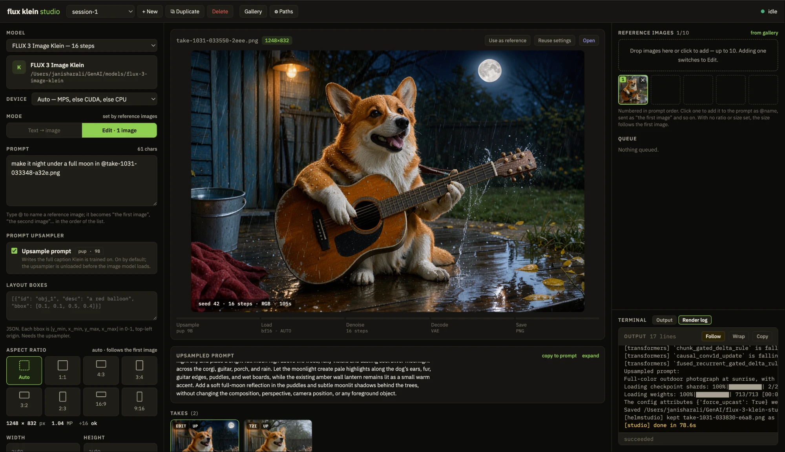

# flux klein studio

**A command line and a local web studio for [FLUX 3 Image Klein](https://huggingface.co/black-forest-labs/flux-3-image-klein)** —
text-to-image, multi-image editing and layout boxes on Apple Silicon, with its
prompt upsampler.

`flux-3-klein` is a small PyTorch CLI around diffusers' Flux3 modular pipeline: it
writes the full caption with the 9B prompt upsampler, frees the upsampler, then
loads the weights straight onto the GPU and renders. The studio in `web/` is a
standard-library Python server that drives that CLI — it builds the arguments,
queues renders and streams their progress, in a browser tab, nothing sent off your
machine. The studio runs as a [helmstudio][helmstudio] studio and only that way:
helmstudio installs it, launches it, keeps its sessions, and takes every finished
take into the library it shares with the other studios. The CLI needs none of that.

The code here is MIT. The Klein weights are not: they are **non-commercial unless
licensed** — see [License](#license).

[](pyproject.toml)
[](#requirements)
[](#license)
[](#license)

<p align="center">
  
</p>

## Table of contents

- [Requirements](#requirements) · [Weights](#weights)
- [The studio](#the-studio) — [Path A: the launcher](#path-a-install-from-the-launcher-recommended) ·
  [Path B: a checkout](#path-b-run-from-a-checkout) ·
  [Using it](#using-the-studio) · [What helmstudio adds](#what-helmstudio-adds) ·
  [Sessions and state](#sessions-and-state)
- [Command line](#command-line) — [Prompt upsampler](#prompt-upsampler) ·
  [Editing](#editing-with-reference-images) · [Layout boxes](#layout-boxes) ·
  [AI disclosure](#ai-disclosure) · [Device](#device) ·
  [Flags](#cli-reference) · [Environment variables](#environment-variables)
- [Security](#security) · [Limits](#limits) · [Contributing](#contributing) ·
  [License](#license)

## Requirements

### Hardware and OS

macOS on Apple Silicon with **64 GB** of unified memory is what this is built on.
The image model is ~20 GB of weights (transformer 11 GB, text encoder 8.9 GB,
VAE 0.3 GB); the 19 GB upsampler is freed before it loads, so the two never sit in
memory together. `--device cuda` and `--device cpu` exist for other machines,
untested here — see [Device](#device).

What the CLI took on an **Apple M5 Pro with 64 GB, torch 2.15 on MPS**, with the
distilled model at 16 steps and seed 42:

| Render | Size | Wall | Peak footprint |
| --- | --- | --- | --- |
| A finished caption, `--no-upsample` (three runs) | 1024×1024 | 36.5–38.9 s | 29.2–30.2 GiB |
| Upsampled text-to-image | 1248×832 | 69.2 s | 32.2 GiB |
| Edit, one 1001×667 reference | 1001×667 | 74.6 s | 27.0 GiB |
| Layout boxes | 1024×1024 | 76.8 s | 29.1 GiB |
| Edit, one reference | 1248×832 | 106.2 s | 31.2 GiB |
| Edit, two references | 1248×832 | 155.5 s | 34.3 GiB |

Wall is the whole command, loading and upsampling included. A step took about
1.9–2.1 s at 1024×1024, 4.6 s at 1248×832 with one reference and 7.5 s with two.
Peak footprint is the honest memory figure, since max RSS misses most Metal memory.
In the upsampled render the footprint went 19 GB during upsampling, 5.9 GB after
the free, 24 GB during denoising and 32 GB at decode, where the fp32 VAE adds 9 GB.
Through the studio the same work took 70.6 s (upsampled 3:2), 104.6 s (edit, one
reference) and 78.6 s (layout boxes).

### Toolchain

| | Why |
| --- | --- |
| [`uv`](https://docs.astral.sh/uv/) | The environment. `uv sync` installs exactly `uv.lock`. |
| `git` | `uv.lock` pins diffusers to its git `main`, where the Flux3 modular pipelines live. |
| [`hf`](https://huggingface.co/docs/huggingface_hub/guides/cli) | Downloading the weights, if helmstudio is not doing it. |
| **helmstudio's `helm`** | The studio only. It does not start without it — see [The studio](#the-studio). |

```bash
uv sync
```

## Weights

Three repositories. A normal render needs the image model and the upsampler; Base
is an optional 50-step model that samples with CFG.

| Weight | Hugging Face | Disk | Used for |
| --- | --- | --- | --- |
| Image model | [`black-forest-labs/flux-3-image-klein`](https://huggingface.co/black-forest-labs/flux-3-image-klein) | ~20 GB, three folders | every render, 16 steps |
| Base | [`black-forest-labs/flux-3-image-klein-base`](https://huggingface.co/black-forest-labs/flux-3-image-klein-base) | ~21 GB by `helmstudio.yaml`; not downloaded here | 50-step renders, when chosen as the model |
| Upsampler | [`black-forest-labs/flux-3-image-klein-pup`](https://huggingface.co/black-forest-labs/flux-3-image-klein-pup) | ~19 GB | every render without `--no-upsample` |

**The Klein repositories are gated.** Open each one on Hugging Face and accept its
licence first, then sign in. The image model's repository holds more than diffusers
reads, so take only its three folders:

```bash
hf auth login
hf download black-forest-labs/flux-3-image-klein --local-dir ~/models/flux-3-image-klein \
  --include "transformer/*" --include "text_encoder/*" --include "vae/*"
hf download black-forest-labs/flux-3-image-klein-pup --local-dir ~/models/flux-3-image-klein-pup
```

Put Base beside the image model, where the studio looks for it. BFL's own code
loads one text encoder and one autoencoder for both models, so only its transformer
is new:

```bash
hf download black-forest-labs/flux-3-image-klein-base --local-dir ~/models/flux-3-image-klein-base \
  --include "transformer/*"
cd ~/models/flux-3-image-klein-base
for d in text_encoder vae; do mkdir -p $d && (cd $d && ln -s ../../flux-3-image-klein/$d/* .); done
```

Link the files, not the two directories: helmstudio follows a file link anywhere,
but refuses a directory link that leaves the weight's own folder.

Without a local copy the CLI downloads from the Hub into the HF cache. Installed
through the launcher, helmstudio downloads the image model and the upsampler
itself, and Base when you fetch it.

## The studio

Two ways in — **the studio never starts on its own**, since whatever launches it
also gives it the platform that keeps its sessions and takes.

| | **A — Install it** | **B — Run from a checkout** |
| --- | --- | --- |
| For | using the studio | changing the studio |
| Needs | the **launcher**, helmstudio's daemon and web UI | the **`helm` CLI**; `helm dev` runs one studio, no daemon |
| Install | **Add a studio** in its library | `git clone`, `uv sync`, `bash web/run.sh` |
| Weights | it downloads or links them | you point `FLUX_MODELS` at them |

### Path A: Install from the launcher (recommended)

**1. Install the launcher** — helmstudio itself, a daemon and a web UI: the Mac
app from [its releases][helm-releases], or a clone:

```bash
git clone https://github.com/janishar/helmstudio && cd helmstudio && make build && ./bin/helmstudio
```

Then open **http://127.0.0.1:8700**; everything lives in `~/.helmstudio`.

**2. Install flux klein studio from its library.** It is in helmstudio's registry,
so it is already listed. Install shows every command it will run — `uv sync --locked`
— and the two weights it will fetch, about 40 GB, or link the ones you have. Accept the Klein licence on Hugging Face first:
helmstudio asks for a token when a gated weight needs one.

**3. Start it.** The launcher gives the studio a port and the weights' paths,
then opens its page → [Using the studio](#using-the-studio).

### Path B: Run from a checkout

The developer's path: a checkout run against helmstudio's platform API under
`helm dev`, which keeps what the studio stores in `./.helm`.

```bash
# 1. helm, the CLI that runs this checkout
/bin/bash -c "$(curl -fsSL https://raw.githubusercontent.com/janishar/helmstudio/main/installer/install.sh)"

# 2. the checkout and its environment
git clone https://github.com/janishar/flux-3-klein-studio && cd flux-3-klein-studio && uv sync

# 3. start, or restart; then `stop` to end it
FLUX_MODELS=~/models bash web/run.sh
bash web/run.sh stop
```

`web/run.sh` checks that `helm` and the runtime SDK are there, links the image
model and the upsampler from `FLUX_MODELS` (default `~/GenAI/models`), and starts
the studio under `helm dev` on **http://127.0.0.1:8740**. Base is not linked: the
studio finds `flux-3-image-klein-base` beside the image model itself. Running the
script again stops the one it started before, so it is also a restart. Only one
`helm dev` can hold `./.helm` at a time; a second one fails with *already locked by
another holder*.

### Using the studio

Write a prompt, press **Generate**. The left pane is every CLI flag:

- **Model** and **Device** — Klein at 16 steps or Base at 50 (change their paths
  under **⚙ Paths**, with the upsampler's) and where to run.
- **Mode** — *Text → image*, or *Edit* as soon as there is a reference image.
- **Prompt** — type `@` to pick a reference image, or click one on the right; it
  is written as `@name` and sent as "the first image", "the second image" and so on
  by the image's place in the list, so removing another image never breaks it.
- **Prompt upsampler** — **Upsample prompt**, on by default.
- **Layout boxes** — the [JSON list](#layout-boxes) `--boxes` reads, typed in;
  disabled while **Upsample prompt** is off.
- **Aspect ratio** — *Auto* or one of the seven, with the size it will render;
  **Width** and **Height** override it.
- **Steps**, **Seed** (⚄ for a random one), and **Guidance** for Base.
- Under **Generate**, the command it will run.

The centre shows the take with its seed, steps and size, the five stages of the
render as they happen (Upsample → Load → Denoise → Decode → Save), the upsampled
prompt beside the original — short, scrollable, **expand** for all of it, **copy to
prompt** to reuse it with Upsample off — and the session's takes. On a take: **Use
as reference**, **Reuse settings**, **Open**, or delete. The right pane holds the
reference images (up to 10), the queue, and the terminal, pinned to the bottom.

### What helmstudio adds

| | |
| --- | --- |
| **Gallery** | helmstudio's own grid over this studio's takes, live. |
| **References from anywhere** | **from gallery** picks an image out of that grid, another studio's included, as a reference. |
| **Render log** | A second Terminal tab streaming the render as helmstudio keeps it; it reconnects after a dropped stream. |
| **The launcher** | A render appears there as a job with its progress and its log, and can be cancelled from there. |

All of it arrives through the same-origin `/helm/` proxy the server mounts, as
do the theme and this studio's green, so the page holds no token of helmstudio's.
There is no timeline: a helmstudio sequence is an edit of video clips, and this
studio makes stills.

### Sessions and state

The studio keeps nothing of its own; helmstudio keeps it all:

| What | Where in helmstudio |
| --- | --- |
| A session's settings and reference images | the session's state |
| Reference images and takes | assets |
| A take with every setting that made it, its upsampled prompt and its inputs | a gallery item |
| A render and its log | a job |
| The paths chosen under **⚙ Paths** | kv |

For an installed studio that is `~/.helmstudio`; for a checkout under `helm dev`
it is `./.helm`. Nothing is written into the repository.

## Command line

```bash
export FLUX_3_KLEIN_PATH=~/models/flux-3-image-klein
export FLUX_3_KLEIN_PUP_PATH=~/models/flux-3-image-klein-pup
uv run flux-3-klein "A neon shop sign that reads KLEIN"
```

Or pass `-m` and `--pup-model` instead of exporting them. The take is written to
`output/output.png`; `--output` puts it elsewhere. Any extension other than PNG,
JPEG, WebP or TIFF falls back to PNG, so the [disclosure](#ai-disclosure) stays.

```bash
uv run flux-3-klein "Swiss poster, 'KLEIN'" --ratio 3:4 --seed 7
uv run flux-3-klein "A bookshelf in warm oak" --width 1024 --height 768
uv run flux-3-klein "A bookshelf in warm oak" -m ~/models/flux-3-image-klein-base --guidance 4
```

Sizes come from the aspect ratio, at about 1 MP, all multiples of 16: `1:1` is
1024×1024, `4:3` 1184×880, `3:2` 1248×832, `16:9` 1360×768, and `3:4`, `2:3` and
`9:16` swap those sides. With no ratio and no reference the size is `1:1`. `--width`
and `--height` override either side and must be multiples of 16.

The transformer's config says whether `-m` is the distilled model or Base: 16 or
50 steps by default, and only Base takes `--guidance`.

### Prompt upsampler

Upsampling is **on by default**, because BFL states the model is not meant to run
without it: Klein is trained on the long captions the upsampler writes, and a short
prompt sent as typed gives weaker results. It does not pick an aspect ratio.

```bash
uv run flux-3-klein "a corgi playing guitar in the rain" --ratio 3:2
```

The upsampler loads first, writes the caption, and is freed before the image model
loads. `--no-upsample` sends the prompt as typed, for a prompt that already is such
a caption. `--pup-model` points at a specific upsampler instead of the environment's.

### Editing with reference images

`--input` takes up to 10 images, comma-separated, and makes the render an edit.
The prompt names them "the first image", "the second image" and so on, in that
order: that is how the upsampler and the image model expect them to be named.

```bash
uv run flux-3-klein "the dog from the first image sitting in the scene from the second image" \
  --input dog.png,lighthouse.png
```

With no ratio set, the **first** image sets the size:

- One reference renders at its own size, fitted under 4 MiB pixels and 4096 on a
  side and never upscaled. It need not be a multiple of 16: it is padded to the grid
  and cropped back, so a 1001×667 reference comes back 1001×667.
- With two or more, the first is fitted under 1 MiB pixels, and each side is floored
  to a multiple of 16.

`--ratio`, `--width` and `--height` override it.

### Layout boxes

`--boxes` takes a JSON file with a list of boxes, each `bbox` being
`[y_min, x_min, y_max, x_max]` in 0-1 from the top left:

```json
[
  {"id": "obj_1", "desc": "a large red hot-air balloon", "bbox": [0.08, 0.08, 0.60, 0.48]},
  {"id": "obj_2", "desc": "a small yellow biplane", "bbox": [0.20, 0.62, 0.42, 0.92]}
]
```

```bash
uv run flux-3-klein "a red hot-air balloon and a yellow biplane over a green valley at sunrise" \
  --boxes boxes.json
```

The upsampler cites each box by its id in the caption and keeps the table exactly,
which is how the image model learns of them, so `--boxes` with `--no-upsample` is
refused. A bad row is refused before the upsampler loads. In the render above, on
the M5 Pro, the balloon and the biplane landed within about 1 to 2% of their boxes,
judged by eye.

For an edit a row can carry `from`, `src_bbox` and `tgt_bbox` instead: `"from":
"target"` with a `tgt_bbox` adds something there, `"from": "ref_image_0"` with both
moves it out of that reference.

The studio takes the same JSON in **Layout boxes**. Its form checks for a non-empty
list of objects with a string `id`; the coordinates are checked by the CLI when the
render starts.

### AI disclosure

Every take carries the EXIF tags BFL's own CLI writes: Software
`AI generated;distilled` (`AI generated;base` for Base) and Make
`Black Forest Labs`. The normal save and the PNG fallback both write them.

### Device

`--device auto` (the default) runs on MPS, else CUDA, else CPU. `mps`, `cuda` and
`cpu` pick one, and asking for one this torch build lacks fails at once. On MPS
the weights load straight onto the GPU, and the MPS cache is emptied after the
upsampler with a workaround for a torch 2.14 deadlock.

```bash
uv run flux-3-klein "A neon shop sign that reads KLEIN" --device cuda
```

### CLI reference

| Flag | Default | Description |
| --- | --- | --- |
| `prompt` | *(required)* | The text prompt. |
| `--input` | *(none)* | Reference images for editing, comma-separated, at most 10. |
| `--ratio` | `1:1`, or the first input's size | `1:1`, `4:3`, `3:4`, `3:2`, `2:3`, `16:9`, `9:16`. |
| `--width`, `--height` | from the ratio | Override one side; a multiple of 16. |
| `--steps` | `16`, or `50` for Base | Denoising steps. |
| `--guidance` | `3.5` | CFG scale, Base only. Refused on the distilled model, which samples without CFG. |
| `--seed` | `42` | Seed for the CPU generator, so the starting noise is the same on every device. For an edit it is mixed with the inputs' pixels, so editing a take with the seed it was made with does not start from the noise that made it. |
| `--boxes` | *(none)* | JSON file with a list of [layout boxes](#layout-boxes). Refused with `--no-upsample`. |
| `-m`, `--model` | `$FLUX_3_KLEIN_PATH`, else `black-forest-labs/flux-3-image-klein` | Local directory or Hub id; a Base directory for 50-step renders. |
| `--no-upsample` | off | Send the prompt as typed, for a prompt that already is the upsampler's caption. |
| `--pup-model` | `$FLUX_3_KLEIN_PUP_PATH`, else `black-forest-labs/flux-3-image-klein-pup` | Upsampler directory or Hub id. |
| `--device` | `$FLUX_3_KLEIN_DEVICE`, else `auto` | `auto`, `mps`, `cuda` or `cpu`. |
| `--output` | `output/output.png` | Where the take is written. |

Besides its human-readable output the CLI prints one line per event for the
studio to read: `@stage upsample|load|denoise|decode|save`, `@step 12/16`,
`@upsampled {"prompt": …}`, and `Saved <abs path> (WxH, mode=RGB)`.

### Environment variables

| Variable | Used as |
| --- | --- |
| `FLUX_3_KLEIN_PATH` | `--model` |
| `FLUX_3_KLEIN_BASE_PATH` | the studio's Base directory (default: `flux-3-image-klein-base` beside the image model) |
| `FLUX_3_KLEIN_PUP_PATH` | `--pup-model` |
| `FLUX_3_KLEIN_DEVICE` | `--device` |
| `FLUX_MODELS` | `web/run.sh`: the directory holding the weights (default: `~/GenAI/models`) |

## Security

The studio has **no authentication**: anyone who can reach its port can run
renders. It binds to `127.0.0.1`, refuses a `Host` it does not recognise (which
blocks DNS rebinding), refuses a cross-origin write, and accepts only JSON for
anything that changes state. `--allow-host` adds a name to accept; binding to
anything but loopback is on you. The terminal is output only, never a shell.

## Limits

- One render at a time, deliberately; the rest wait in the queue.
- Each render loads the upsampler and the model afresh.
- **Inference runs on the diffusers Flux3 modular pipeline**, since BFL's own code
  is CUDA-only. So a seed does not reproduce an image from BFL's code: diffusers
  draws its noise differently. The same command does repeat here: three runs on the
  M5 Pro gave identical pixels.
- **Sampling** is diffusers' default: shift 6.93, and CFG 3.5 for Base. BFL's newest
  repo commit, `62e90b9` of 2026-10-17, moved to alpha 16 and CFG 4, which the
  diffusers release pinned here does not follow.
- **Base is untested here**: its weights are not downloaded, so its 50 steps, its
  guidance and the links above have never run.
- Also not exercised here: CUDA and CPU, loading from a Hub id, three or more
  references, `--ratio` or a single typed side with `--input`, and boxes on an edit.
- The studio has been run under `helm dev` only, not installed through the launcher.
- The upsampler is never told the output size: `--ratio` and the size flags reach
  the image model only.
- Only **Denoise** has progress of its own; the other stages' bars sit at a fixed
  width until they finish.
- `@step` wraps `scheduler.step`, and the CLI switches tqdm off inside diffusers'
  denoise blocks; a diffusers update that moves them fails with `KeyError`.
- `peak_ram_gb: 32` in `helmstudio.yaml` is an estimate, and low: two references
  reached 34.3 GiB on the M5 Pro. `ram_gb: 48` is an estimate too.
- `helmstudio.yaml` requires an Apple Silicon Mac, so only the CLI runs elsewhere.

## Contributing

Bug reports, feature requests and pull requests are welcome. Two conventions:
no Python dependencies for the studio beyond helmstudio's runtime SDK, and no
front-end build step — `web/static/` is served as written. The checks are plain
scripts: `.venv/bin/python tests/test_generate.py` and
`.venv/bin/python web/test_server.py`.

## License

This code is MIT — see [LICENSE](LICENSE). That covers the code only.

The FLUX 3 Image Klein weights, Base included, are under the
[FLUX Kommunity License](https://huggingface.co/black-forest-labs/flux-3-image-klein/blob/main/LICENSE.md).
**They are non-commercial unless licensed.** Commercial use needs a licence from
[Black Forest Labs](https://bfl.ai/licensing), or falls under the one exception in
section 2.a: a Qualifying User, with under US$5,000,000 in gross annualized revenue
together with affiliates, may use Output commercially.

Section 2.e obliges that Qualifying User to run content filters or to have Output
reviewed for unlawful or infringing content before it is distributed, and to
disclose AI generation where the law requires it. **This project includes no content
filter**, so meeting 2.e is yours to do; the EXIF tags are its only disclosure. Read
the licence itself: this summary does not replace it.

The prompt upsampler is under Apache 2.0.

[helmstudio]: https://github.com/janishar/helmstudio
[helm-releases]: https://github.com/janishar/helmstudio/releases
